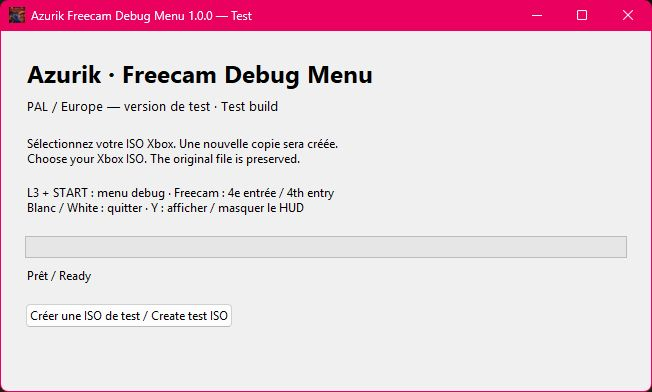
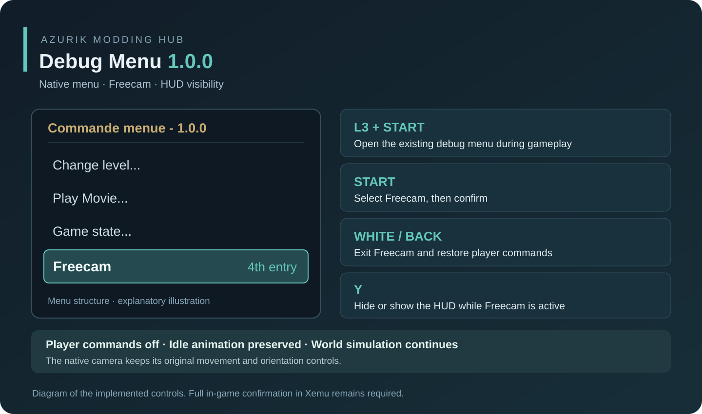

# Azurik Debug Menu

A standalone **PAL / European Xbox test patch** for *Azurik: Rise of Perathia*.
It extends the **existing in-game debug menu** with **Freecam** and invokes the native
camera used by the original cheat. The world continues updating while Azurik's
controls are disabled. His idle animation, physics and update scheduling continue.
Press **WHITE** to return to normal player controls;
press **Y** to hide or show the HUD.

The patch uses shared game code and the currently loaded gameplay camera. It
applies across **all playable kingdoms** in the supported European build, with
no W1 restriction. Individual kingdoms still need in-game verification. Activate
freecam during loaded gameplay, rather than on the title or loading screens.

**Version: 1.0.0.** Isolated x86 tests and ISO readback verification
are provided. A complete in-game test is still required, including collisions,
menu transitions and HUD behaviour. No game executable, ISO, save, model or texture
is distributed in this repository or its downloads.

[Guide français](README.fr.md) · [Technical notes](docs/IMPLEMENTATION.md)
· [Azurik Level Editor](https://github.com/Azurik-Modding-Hub/Azurik-Level-Editor)



Desktop patcher interface captured in version 1.0.0. In-game validation remains pending.



This diagram explains the menu structure and controls; it does not depict an in-game test.

Version **1.0.0** fixes Azurik remaining frozen after leaving Freecam. The earlier
patch skipped his whole update, including its re-registration for future frames.
Freecam now uses the game's native blocked-input path: player buttons and movement
axes are neutralized, while animation and normal frame maintenance continue.
The native camera-enabled flag restores controls on exit even if a camera pointer
briefly remains in the stack. Confirm idle animation and exit behavior in Xemu.

## Development preview: native Debug Laboratory

The `feature/native-debug-laboratory` branch adds **WHITE + A + B** to open the
native menu directly during loaded gameplay. **L3 + START** remains available.
The menu is in English, with **Text boxes**, **Oracles**, and **Game state → Keys**
for all 20 supported key types. Fragment/seal messages are under Text boxes;
additional spoken-only hints are labelled explicitly. There is no Animations
category. Key grants respect the five inventory slots and do not replace held
keys. This is **1.1.0-dev.2**, separate from the stable 1.0.0 Windows patcher.
[Preview workflow, shortcuts and testing limits](docs/LABORATORY.md).

## Controls

| Action | Xbox controller |
| --- | --- |
| Open the native debug menu | **L3 + START** |
| Activate the original freecam | Select **Freecam**, then confirm with **START** |
| Camera movement and orientation | Original native camera controls |
| Hide / show the HUD | **Y**, while freecam is active |
| Exit freecam | **WHITE**; native **BACK** is also preserved |
| Original cheat activation | **RT, D-pad Down, Up, Down, Up, R3, L3** |

For the original sequence, release each button before the next; do not keep RT
held throughout it. WHITE is an exit button. No WHITE + R3 activation is added.
The HUD returns to its previous visibility when exiting with WHITE or BACK.

**Freecam is the fourth entry in the game's existing root debug menu**, alongside
the European build's original **Change level...**, **Play Movie...** and
**Game state...** entries. It is available as soon as that native menu opens;
there is no extra submenu to open. The three existing entries are preserved.
The Windows patcher installs this change into your new ISO; it is not the debug
menu itself.

The native debug-menu header displays **Commande menue - 1.0.0**, replacing
the old Azurik build label. **L3 + START** opens this menu during gameplay;
choose **Freecam** and confirm with **START**.

## Windows

Download the **Windows patcher** from [1.0.0 release](https://github.com/Azurik-Modding-Hub/Azurik-Debug-Menu/releases/tag/v1.0.0).
Open `Azurik Freecam Patcher.exe`, choose your own Azurik Xbox ISO/XISO, and choose
a **new** output file. The patcher copies the image, installs the new executable
in that copy, and verifies the complete game data. It never replaces an existing
output or changes the input image.

Boot the new image in Xemu with a full console restart. An old emulator snapshot
can keep the previous executable in memory. Your original image remains the
rollback copy. To remove the patch, boot that original image again.

Check that the root debug menu has **four** entries, including **Freecam**.
If it still has only the three original entries, verify the selected ISO and
cold-boot that new image before testing the camera.

EDIT : You need to clear the cache for the changes you make to take effect ! Don’t worry, this won’t affect your save files in any way!

Only clear Xbox cache partitions X/Y/Z. Keep partition E and the virtual disk
containing your saves. The patcher itself never clears cache or changes saves.

## From source

Python **3.10 or newer** is sufficient to run the patcher; no runtime packages
are required. Windows Python includes the desktop interface through Tkinter.

```powershell
python patcher.py
python patcher.py --input "Azurik.iso" --output "Azurik-Freecam-Debug.iso"
python patcher.py --input "default.xbe" --output "default-freecam.xbe"
```

Only the pristine PAL/EU executable is supported. Its SHA-256 is
`72e0cf6af079a4024886d9e94812d87d4a35c177135b6196d215abe138866eab`.
Other regions, previously patched executables, and truncated inputs are refused.
An ISO with edited levels is supported if its executable is still this original
build: **all level files remain byte-for-byte identical** to the input ISO.

## Testing and building

```powershell
python -m pip install -r requirements-dev.txt
python -m pytest -q
```

Optional local retail validation (the game file is not uploaded or committed):

```powershell
$env:AZURIK_XBE = "C:\YourOwnDump\default.xbe"
python -m pytest -q
```

To build the desktop patcher:

```powershell
python -m pip install pyinstaller
powershell -File ".\Build Windows.ps1"
```

## Scope

- The native debug menu's existing tools remain available.
- Simulation, other actors and effects continue during freecam.
- Azurik's movement, attack and jump commands are disabled during Freecam.
  Animation, idle motion, physics and frame scheduling continue. Normal player
  controls return on exit. Gravity, moving platforms and scripted actions still
  follow the game's normal simulation.
- Camera-only travel does not make player-triggered portals load other levels.
- The patch changes the executable and its ISO directory pointer. It does not
  modify level assets, save files, EEPROMs or emulator settings.

The reverse-engineering context comes from
[JTCPP / Elemental Games Modding](https://github.com/JTCPP/Elemental_Games_Modding)
and [Elemental Games Modding — Expensions](https://github.com/Azurik-Modding-Hub/Elemental_Games_Modding---Expensions).
This standalone implementation targets the verified PAL executable rather than
assuming the USA addresses from older symbol tables apply.

## Future additions

This repository is the home for further additions to Azurik's native debug menu.
The first test release focuses on freecam. New menu actions and debugging tools
will be added incrementally, with their own compatibility checks and tests.
The desktop patcher is the installer for these game changes.
