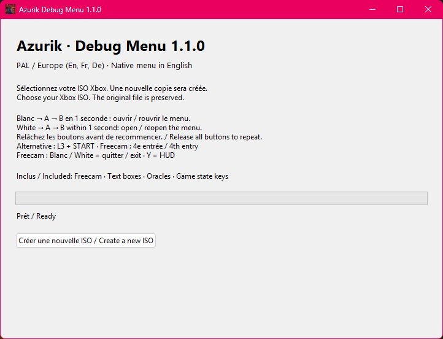
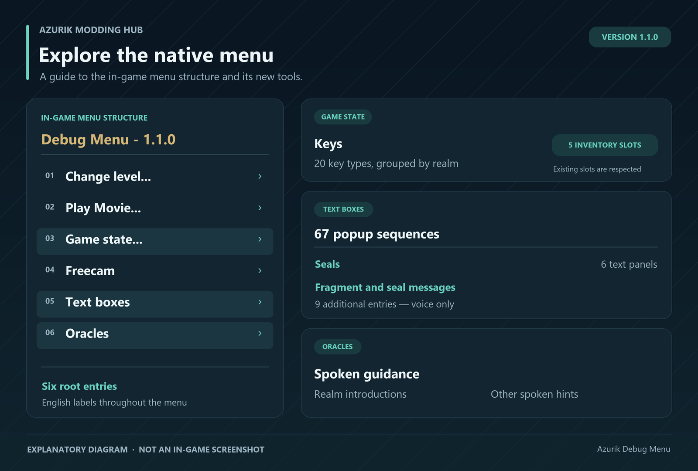

# Azurik Debug Menu

**Version 1.1.0** extends the existing Xbox debug menu in *Azurik: Rise of Perathia*
with Freecam, text-box and oracle voice previews, and key grants. During loaded
gameplay, press **WHITE → A → B within one second** to open it. Close it normally,
release the buttons, and use the same sequence to reopen it without the original
cheat code.

The in-game menu is **English** and displays **Debug Menu - 1.1.0**. The Windows
patcher installs it into a new copy of your own supported **PAL / European ISO**.
No game executable, ISO, save, model, texture or recording is distributed here.

[Download 1.1.0](https://github.com/Azurik-Modding-Hub/Azurik-Debug-Menu/releases/tag/v1.1.0)
· [Guide français](README.fr.md) · [Detailed guide](docs/LABORATORY.md)
· [Technical notes](docs/IMPLEMENTATION.md)
· [Azurik Level Editor](https://github.com/Azurik-Modding-Hub/Azurik-Level-Editor)



Actual desktop patcher interface from version 1.1.0. This capture does not show an
in-game test.



Explanatory diagram of the menu structure, not a screenshot from the game.

## Features

The root menu has **six entries**: **Change level...**, **Play Movie...**,
**Game state...**, **Freecam**, **Text boxes** and **Oracles**.

- **Freecam** uses the original game's detached camera. Player movement, attack
  and jump commands are disabled while idle animation, physics and world updates
  continue. **WHITE** or **BACK** exits; **Y** hides or shows the HUD.
- **Text boxes** previews 67 original popup sequences with their voices where
  available. Seal panels and fragment/seal messages are grouped here. Additional
  recordings without an identified panel are explicitly marked **(voice only)**.
- **Oracles** previews realm introductions and other spoken hints. Fragment/seal
  messages are under Text boxes rather than duplicated here. **Stop voice** ends
  a voice preview.
- **Game state → Keys (5 inventory slots)** provides all 20 verified key types,
  grouped by realm. **Give: ...** uses the game's inventory pickup routine. A key
  already held is not duplicated, and a full inventory does not replace any key.

There is no **Animations** category or manual animation playback. Normal game
animations and Azurik's idle movement remain active. The shared Freecam code
applies across all playable kingdoms in the supported build; each kingdom still
needs full in-game verification.

## Controls

| Action | Xbox controller |
| --- | --- |
| Open or reopen the debug menu | **WHITE, then A, then B within one second** |
| Alternative menu shortcut | **L3 + START** |
| Select or activate a menu item | Native menu controls; confirm with **START** |
| Activate Freecam | Select **Freecam**, then **START** |
| Move and aim the camera | Original native camera controls |
| Hide / show the HUD in Freecam | **Y** |
| Exit Freecam | **WHITE** or **BACK** |

The one-second window starts at WHITE. Buttons may be released between steps;
overlapping presses also work. Release the gesture buttons before beginning a
new sequence. An incomplete or expired sequence needs a fresh WHITE press.
The shortcut reuses a normally closed native menu and does not stack another
window over an already open menu. The original cheat code remains available.

WHITE alone still exits Freecam. The shortcut does not enable the retail
additional cheat-button actions that previously gave WHITE a jump/boost action.
After leaving Freecam, the HUD returns to its previous visibility.

## Install on Windows

1. Download and extract the Windows package from the
   [1.1.0 release](https://github.com/Azurik-Modding-Hub/Azurik-Debug-Menu/releases/tag/v1.1.0).
2. Open **Azurik Freecam Patcher.exe** and choose your own supported Xbox ISO/XISO.
3. Choose a **new output ISO**. The tool copies the image, patches its executable
   and verifies the complete result. It refuses existing output files.
4. Load the new ISO in Xemu and perform a full console restart. An old emulator
   snapshot can retain the previous executable in memory.
5. During loaded gameplay, press **WHITE → A → B within one second**.

Check the title **Debug Menu - 1.1.0** and the six root entries. An older title or
only three/four entries indicates that an earlier build is still being loaded.
The patcher never changes the input image. To return to the original game, boot
your original image again.

EDIT : You need to clear the cache for the changes you make to take effect ! Don’t worry, this won’t affect your save files in any way!

Only clear Xbox cache partitions **X/Y/Z**. Keep partition **E** and the virtual
disk containing your saves. The patcher itself does not clear caches or alter
saves, EEPROMs or emulator settings.

## Compatibility and limits

Only the pristine supported PAL/EU executable is accepted. Its SHA-256 is
`72e0cf6af079a4024886d9e94812d87d4a35c177135b6196d215abe138866eab`.
Other regions, truncated files and previously patched executables are refused.
Edited levels are supported if their ISO still contains this original executable:
all level assets stay byte-for-byte identical to the input image.

Text-box and voice previews run after closing the menu, during a normal scheduled
frame in the same live world. They do not change quest flags. Key grants change
the inventory and can be retained by the game's normal save system. Previewing a
voice does not create an oracle appearance or a new matching text panel.
Localized playback follows the game's language; the original demo popup voices
exist only in English. The original E6 mirror panel/voice name mismatch is not
changed by this executable-only patch.

Camera-only travel does not trigger portals that depend on the player's position.
Gravity, moving platforms and scripted actions continue using the game's normal
simulation. Activate the menu during loaded gameplay, outside title/loading screens.

## From source

Python **3.10 or newer** runs the patcher without additional runtime packages.
Windows Python provides the desktop interface through Tkinter.

```powershell
python patcher.py
python patcher.py --input "Azurik.iso" --output "Azurik-Debug-Menu-1.1.0.iso"
```

The dedicated ISO command-line entry point is also available:

```powershell
python laboratory_patcher.py --input "Azurik.iso" --output "Azurik-Debug-Menu-1.1.0.iso"
```

## Validation and building

**247 automated tests passed**, including the default desktop/CLI release path.
The compiled Windows application produced the expected 1.1.0 executable and a
fully verified ISO while preserving the original image. These
isolated native x86 tests and ISO readback checks are not a complete Xemu gameplay
test. Repeated menu opening/closing, idle animation, control restoration, realm
transitions, HUD and the previews still require in-game confirmation.

```powershell
python -m pip install -r requirements-dev.txt
python -m pytest -q
```

Optional local retail validation; the game file is not uploaded or committed:

```powershell
$env:AZURIK_XBE = "C:\YourOwnDump\default.xbe"
python -m pytest -q
```

Build the Windows patcher:

```powershell
python -m pip install pyinstaller
powershell -File ".\Build Windows.ps1"
```

The reverse-engineering context comes from
[JTCPP / Elemental Games Modding](https://github.com/JTCPP/Elemental_Games_Modding)
and [Elemental Games Modding — Expensions](https://github.com/Azurik-Modding-Hub/Elemental_Games_Modding---Expensions).
The implementation targets the verified European executable; it does not assume
that addresses from other regions apply.
